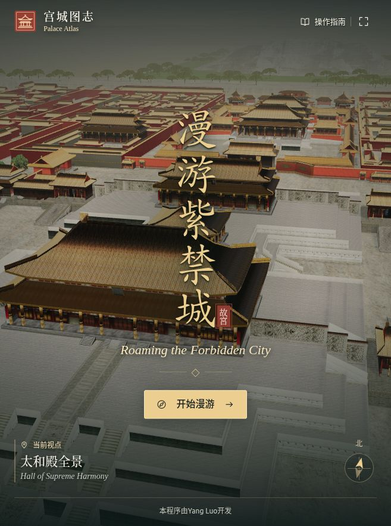

# 漫游紫禁城 · 交互与开发方案

## 这次要验证的体验

面向初次了解故宫的访客，以 Android 横屏平板为主要载体。一次短途参观从午门到保和殿，让访客能在三维场景中指出宫门、辨认三大殿，并举出至少一项与建筑用途有关的史实。首版以五个可实地核对的地点验证「找到建筑 → 看清形制 → 了解人物和事件 → 回到全景」的闭环。允许随时跨站，自由探索整份模型。完整的六百年内容待首轮反馈后分批扩展。

## 首屏与镜头

- 使用同一座 Three.js 场景，从南侧高空向北飞越外朝院落，下降至太和殿的斜向全景。镜头在终点停住，留出观察屋顶和台基的时间。
- 中央竖排金色楷书「漫游紫禁城」，下置横排英文题名与「开始漫游」。底部保留「本程序由Yang Luo开发」。暖金日照、墨色面板、朱砂印记沿用到探索界面。
- 飞行时即可开始漫游，立即切到终点。系统开启减少动态效果时直接显示终点。场景加载中展示真实模型预览与状态；资源出错时提供重试。
- 建筑和镜头由 WebGL 绘制。可读文字、按钮、资料面板叠加在同一视口，热点从模型世界坐标投影到屏幕，支持系统字体、焦点和触控。

## 探索模式与触控

| 动作 | Android 平板 | 鼠标 / 键盘 | 结果 |
| --- | --- | --- | --- |
| 环绕 | 单指拖动 | 左键拖动 | 绕当前观察中心旋转，限制俯仰避免钻入地下 |
| 缩放、平移 | 双指捏合、同向移动 | 滚轮、右键拖动 | 调整观看距离和中心，另提供缩放按钮 |
| 查看建筑 | 轻点热点或目录项 | 悬停先看名称和图片，点击或 Enter 进入 | 切换建筑专属镜头，抵达后展开资料 |
| 全景 | 点全景按钮 | 点击同一按钮 | 拉远至能容纳五个热点的全景；打开标注 |
| 显示标注 | 点标注开关 | 同左 | 隐藏或恢复呼吸光点，不改变当前镜头 |
| 查历史 | 点历史年表 | 同左 | 年代、事件与可定位地点联动 |
| 返回探索 | 关闭资料面板 | 关闭按钮或 Esc | 保留已选建筑视角，继续旋转或重新选择 |

按钮和命中区域至少 44 CSS 像素。远景光点挤在一起时，横向错开命中区，用细线连回屋脊。建筑目录也支持按名称精确选取。横屏使用侧栏、竖屏使用底部面板。控件避开安全区，资料可独立滚动。系统降低动画时取消光点呼吸与飞行。碰撞漫步、室内观察和语音讲解留到后续需求确认。

## 学习内容与维护

每座建筑有稳定 ID、中文名、英文名、所属区域、模型锚点、专属相机偏移、缩略图、形制、用途、人物事件和院方来源。缩略图取自本模型，可对照屏幕上的具体建筑。原始 GLB 以材质分网格，用屋脊世界坐标绑定热点；替换模型后逐点核对朝向与位置。年表独立维护，只有发生地点明确的条目才关联建筑。

| 首轮地点 | 在场景中看什么 | 能回答的问题 |
| --- | --- | --- |
| 午门 | 凹字形城台与南向两翼 | 怎样辨认宫城正门？ |
| 太和门 | 前朝主要宫门及其院落 | 顺治帝在这座宫门颁过什么诏令？ |
| 太和殿 | 三层台基、重檐庑殿顶 | 康熙帝在哪里举行亲政大典？ |
| 中和殿 | 方形平面、四角攒尖顶 | 皇帝临大典前在哪里准备？ |
| 保和殿 | 三台最北端的殿宇 | 乾隆时期，殿试地点发生了什么变化？ |

史实以故宫博物院建筑条目和院刊为依据。区分初建、重建、改名，标记事件发生时的殿名。全城年表覆盖明代营建、清代礼制、博物院开放与当代保护；模型呈现的是一份固定场景，暂不按朝代更换外观。正式版每条记录增加审核人、来源条目、修订日期和图片许可。编辑验收同时核对文案、史源和镜头。

资料入口：[午门](https://www.dpm.org.cn/building/talk/223745.html)、[太和门](https://www.dpm.org.cn/explore/building/236439.html)、[太和殿](https://www.dpm.org.cn/explore/building/236465.html)、[中和殿](https://www.dpm.org.cn/explore/building/236464.html)、[保和殿](https://www.dpm.org.cn/explore/building/236434.html)、[清代殿试制度](https://www.dpm.org.cn/court/system/236363.html)、[康熙亲政与御门听政](https://www.dpm.org.cn/journal/251996.html)、[故宫六百年](https://www.dpm.org.cn/subject_600/)。

## JavaScript 工程与文件管理

采用原生 JavaScript ES Modules、Three.js、GLTFLoader、OrbitControls 和 Vite。浏览器端直接运行，npm 锁定依赖版本，静态构建产物可复制到平板所在网络的 HTTP 服务。模型 7.8 MB，34 个网格，共 117,818 个三角形。27 张外部纹理约 13 MB；保留原文件名、大小写及相对目录。构建时复制 GLB 与纹理，避免哈希重命名破坏模型的外部 URI。HTML 入口和静态资产使用相对部署基址。

```text
index.html                     页面语义、开场和场景控件
src/main.js                    状态、面板、热点和输入协调
src/scene.js                   加载、镜头、投影、渲染
src/content.js                 建筑档案、年表、来源
src/style.css                  平板横竖屏和动态效果
public/media/                  开场预览、模型视图和题字字形
forbidden_city.glb             原始模型
textures/                      GLB 引用的原始纹理
docs/                          设计、验收约定及后续评审记录
vite.config.js                 静态资源构建
package.json / package-lock.json
dist/                          可部署目录，由构建生成
```

视图状态为加载、序幕、自由探索、飞向建筑、阅读档案；建筑目录、年表、帮助共用面板。新选点取消旧镜头回调，关闭资料后可继续操作。使用一个渲染器和一份模型；仅相机变化时重绘静止场景，后台标签暂停绘制。阴影可静态烘算，平板限制像素比。性能验证关注解码后纹理驻留、首次加载与旋转帧率，先实测再决定是否采用 KTX2、LOD、分区加载。

## 里程碑、分工与验收

| 阶段 | 可交付范围 | 进入下一阶段的依据 |
| --- | --- | --- |
| P0 本地 Demo | 五个地点、开场飞行、自由探索、图文资料与简明年表 | 由你试用并确定飞行速度、视角、文字密度及主要入口 |
| P1 内容与路线 | 按外朝、内廷、御花园拆分资料，补充已核对的建筑与人物路线 | 每个地点都有来源和对应镜头；一位初次使用者可独立完成一条路线 |
| P2 平板验收 | 目标设备横竖屏、性能分档、弱网重试与离线资源 | 记录实际机型和 Chrome/WebView 版本，目标交互帧率 ≥30 FPS，连续漫游 20 分钟无崩溃 |
| P3 发布与维护 | 根据部署场景确定静态站、离线 PWA 或 Android WebView 壳；补齐资源许可与回滚包 | 在交付平板上验证冷启动、升级、离线策略、系统返回键和版本回滚 |

使用 Git 管理源文件、内容数据及锁文件。按交互、三维资源、史料、平板兼容四类建立事项，每项注明复现步骤、依赖和验收场景。任务走待办、开发、验证、完成四列。按功能短分支提交，每个合并请求附桌面与平板截图、改动建筑 ID 和核对来源。原始模型变更单独提交并保留版本；大文件频繁迭代时再引入 Git LFS。忽略依赖和构建目录。版本用 v0.x 标记评审包，下一阶段范围由本轮意见确定。

首轮验收顺序：冷启动观察飞行 → 提前进入 → 捏合/滚轮缩放 → 全景查看五处光点 → 切换标注 → 触控打开中和殿 → 阅读并关闭 → 从年表定位太和殿 → 快速切换目的地 → 旋转屏幕并恢复全景。另测资源缺失、无 WebGL、浏览器退后台、减少动态效果与键盘焦点。将「感受不顺」的问题记录为具体机型、操作与期望画面。

## 启动

开发环境使用 Node.js 22.12+ 或本项目验证所用的 Node.js 24。首次执行 `npm ci`，之后执行 `npm run dev`，打开终端打印的地址。同一局域网的平板可通过 `npm run dev -- --host 0.0.0.0` 与电脑的局域网 IP 访问。正式构建执行 `npm run build`，使用 `npm run preview` 验证产物，将整个 `dist/` 放入静态服务器。直接双击 HTML 无法加载 ES 模块与模型。

## P0 验证记录

本地浏览器已载入原始模型，核对了开场停驻、远景五个热点、中和殿专属视角、标注关闭，以及从年表「康熙帝亲政」进入太和殿档案。横竖视口分别验证。生产构建包含模型引用的全部 27 张纹理及五张缩略图。真实 Android 平板的多点触控、持续帧率、温升和内存峰值留待 P2 在目标机型上记录。

开场题字采用文鼎楷书 AR PL UKai CN 的本地子集。字体许可随文件放在 `public/media/ARPHICPL.TXT`。建筑图片由本项目模型生成。


